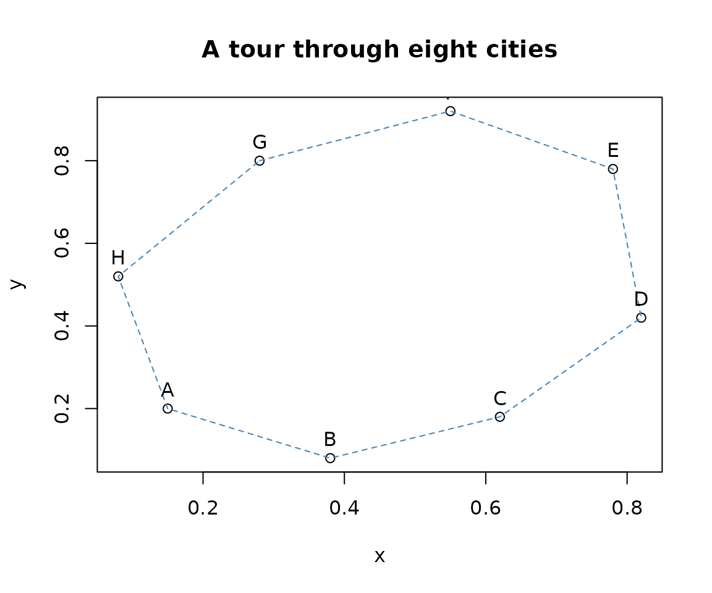

# Getting started with TSP

This vignette introduces how to solve TSP problems using the R package
**TSP** (Hahsler and Hornik 2007). The traveling salesperson problem
asks for the shortest round trip that visits each city exactly once. The
**TSP** package provides classes for representing traveling salesperson
problems, several construction and improvement heuristics, and
interfaces to the external Concorde solver.

This vignette covers the typical workflow:

1.  Create a problem from coordinates or a distance matrix.
2.  Find a tour with
    [`solve_TSP()`](https://michael.hahsler.net/TSP/reference/solve_TSP.md).
3.  Inspect, and visualize a solution.

## Installation

Install the released version from CRAN:

``` r

install.packages("TSP")
```

Then load the package:

``` r

library(TSP)
```

## Basic Usage

### Create a TSP problem from coordinates

The standard representation of a symmetric TSP is a distance matrix. For
locations described by coordinates you can calculate distances before
creating the TSP object. Here we create a Euclidean traveling
salesperson problem fro ma dataframe with coordinates. Row names are
used as city labels.

``` r

cities <- data.frame(
  x = c(0.15, 0.38, 0.62, 0.82, 0.78, 0.55, 0.28, 0.08),
  y = c(0.20, 0.08, 0.18, 0.42, 0.78, 0.92, 0.80, 0.52),
  row.names = LETTERS[1:8]
)

problem <- TSP(dist(cities))
problem
#> object of class 'TSP' 
#> 8 cities (distance 'euclidean')
n_of_cities(problem)
#> [1] 8
labels(problem)
#> [1] "A" "B" "C" "D" "E" "F" "G" "H"
```

Note, that there are other representations for Euclidean TSPs
[`ETSP()`](https://michael.hahsler.net/TSP/reference/ETSP.md) and
asymmetric TSPs
[`ATSP()`](https://michael.hahsler.net/TSP/reference/ATSP.md) available.
Most algorithms will convert them into a distance-based representation
first.

### Solve the problem

[`solve_TSP()`](https://michael.hahsler.net/TSP/reference/solve_TSP.md)
returns a `TOUR`, an integer permutation giving the order in which the
cities are visited. The default combines arbitrary insertion with 2-opt
improvement.

``` r

set.seed(123)
tour <- solve_TSP(problem)
tour
#> object of class 'TOUR' 
#> result of method 'arbitrary_insertion+two_opt' for 8 cities
#> tour length: 2.430432
as.integer(tour)
#> [1] 7 6 5 4 3 2 1 8
labels(tour)
#> [1] "G" "F" "E" "D" "C" "B" "A" "H"
tour_length(tour)
#> [1] 2.430432
```

The stored tour length includes the final edge from the last city back
to the first. A TSP solution is therefore a cycle, not an open path.

Plot the coordinates and the resulting tour with
[`plot()`](https://rdrr.io/r/graphics/plot.default.html):

``` r

plot(ETSP(cities), tour, main = "A tour through eight cities", tour_col = "steelblue")
```



## Where to go next

Read about the [available TSP
solvers.](https://michael.hahsler.net/TSP/articles/solution_methods.html)

The most useful help pages are:

- [`?solve_TSP`](https://michael.hahsler.net/TSP/reference/solve_TSP.md)
  for all solvers and their control parameters;
- [`?TSP`](https://michael.hahsler.net/TSP/reference/TSP.md),
  [`?ETSP`](https://michael.hahsler.net/TSP/reference/ETSP.md), and
  [`?ATSP`](https://michael.hahsler.net/TSP/reference/ATSP.md) for
  problem representations;
- [`?TOUR`](https://michael.hahsler.net/TSP/reference/TOUR.md) and
  [`?tour_length`](https://michael.hahsler.net/TSP/reference/tour_length.md)
  for working with solutions;
- [`?read_TSPLIB`](https://michael.hahsler.net/TSP/reference/TSPLIB.md)
  and
  [`?write_TSPLIB`](https://michael.hahsler.net/TSP/reference/TSPLIB.md)
  for TSPLIB files; and
- [`?insert_dummy`](https://michael.hahsler.net/TSP/reference/insert_dummy.md)
  and
  [`?cut_tour`](https://michael.hahsler.net/TSP/reference/cut_tour.md)
  for turning a cycle into one or more paths. \## References

Hahsler, Michael, and Kurt Hornik. 2007. “TSP – Infrastructure for the
Traveling Salesperson Problem.” *Journal of Statistical Software* 23
(2): 1–21. <https://doi.org/10.18637/jss.v023.i02>.
