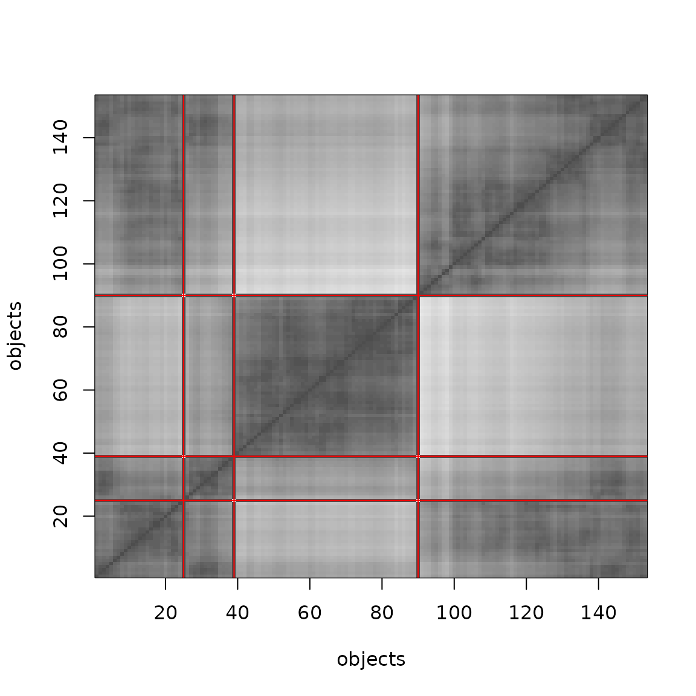
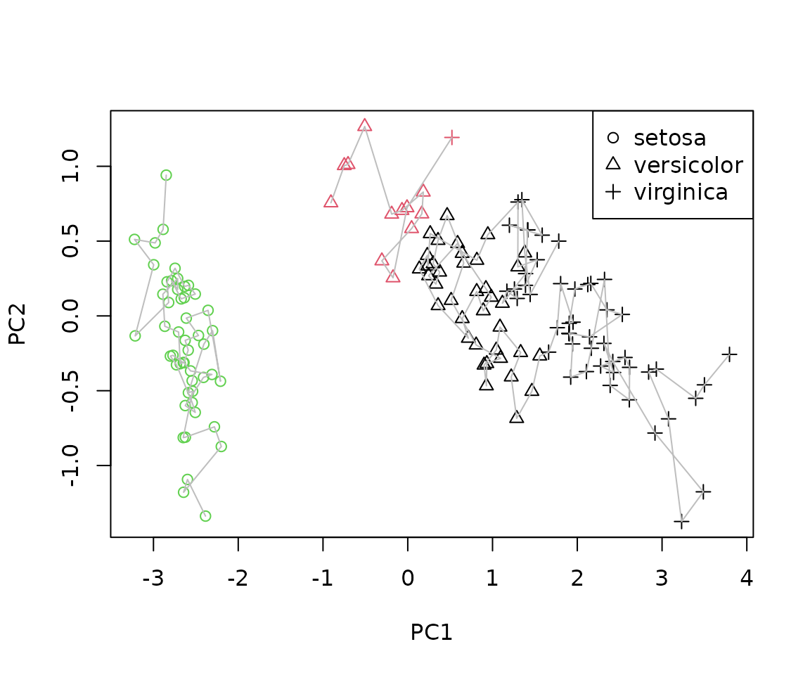
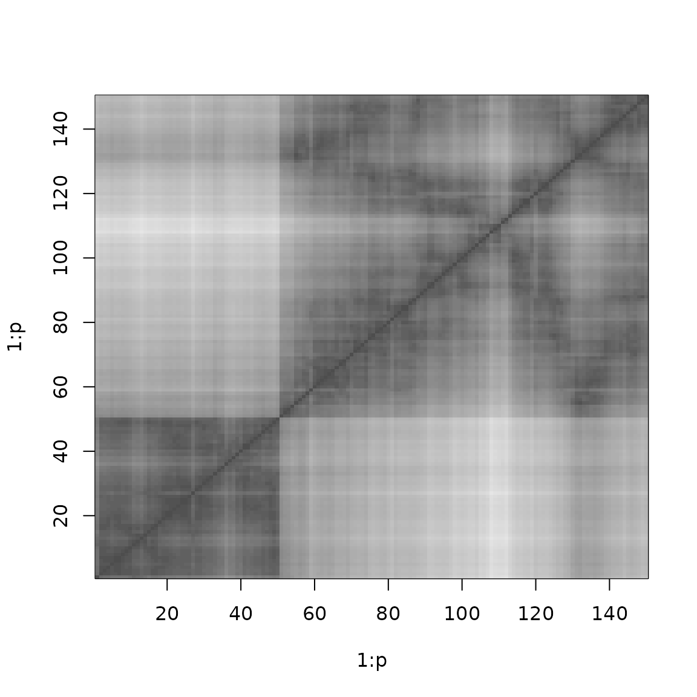

# Rearrangement clustering

This vignette shows how to use the R package **TSP** (Hahsler and Hornik
2007) for rearrangement clustering. Solving a TSP can be used to cluster
objects and to find a linear order of objects. This was suggested
several times in the literature (Lenstra 1974; Alpert and Kahng 1997;
Johnson et al. 2004). The idea is that objects in the same cluster are
visited consecutively, so a short tour through all objects only makes a
large “jump” when it moves from one cluster to the next.

Climer and Zhang (2006) call this approach *rearrangement clustering*
and show how the cluster boundaries can be found automatically: to
obtain \\k\\ clusters, add \\k\\ *dummy cities* that have the same
constant distance to all other cities and are infinitely far from each
other. In an optimal tour, the dummy cities must separate the most
distant groups of cities and thus represent the cluster boundaries.

In **TSP**, dummy cities are added with
[`insert_dummy()`](https://michael.hahsler.net/TSP/reference/insert_dummy.md)
and the tour is split into paths (clusters) with
[`cut_tour()`](https://michael.hahsler.net/TSP/reference/cut_tour.md).

## Preparing the problem

We use the iris data, which contains measurements for 150 flowers of
three species. Since we know the species, we can check how well the
clustering recovers them. We create a TSP from the Euclidean distances
between the measurements and use the species as city labels.

``` r

data("iris")
x <- iris[, 1:4]

tsp <- TSP(dist(x), labels = iris$Species)
tsp
#> object of class 'TSP' 
#> 150 cities (distance 'euclidean')
```

Now we add three dummy cities labeled `"boundary"`.

``` r

tsp_dummy <- insert_dummy(tsp, n = 3, label = "boundary")
tsp_dummy
#> object of class 'TSP' 
#> 153 cities (distance 'euclidean')
```

The default constant distance of 0 is guaranteed to work if the solver
finds the optimal tour. For heuristics, which are not optimal, a larger
`const` (e.g., `2 * max(tsp)`) may give better results.

## Solving

We solve the problem with the default heuristic. Since the heuristic is
not optimal, it is not guaranteed that the dummy cities represent the
best cluster boundaries.

``` r

tour <- solve_TSP(tsp_dummy, rep = 10, seed = 100)
#> Warning: executing %dopar% sequentially: no parallel backend registered
tour
#> object of class 'TOUR' 
#> result of method 'arbitrary_insertion+two_opt_rep_10' for 153 cities
#> tour length: 47.75516
```

## Visualizing the result

The permuted distance matrix shows the clusters as dark blocks along the
diagonal. Light areas represent large distances. The red lines mark the
positions of the dummy cities in the tour, i.e., the cluster boundaries.

``` r

image(tsp_dummy, tour, xlab = "objects", ylab = "objects")

boundaries <- which(labels(tour) == "boundary")
abline(h = boundaries, col = "red")
abline(v = boundaries, col = "red")
```



## Extracting the clusters

[`cut_tour()`](https://michael.hahsler.net/TSP/reference/cut_tour.md)
cuts the tour at the dummy cities and returns the paths between them.
Each path is a cluster. Here, we get a list of index vectors into the
original data (the dummy cities are excluded).

``` r

clusters <- cut_tour(tour, cut = "boundary")
lengths(clusters)
#> boundary boundary boundary 
#>       87       13       50
```

Because the tour is a cycle, the part of the tour after the last dummy
city is connected to the beginning of the tour, and
[`cut_tour()`](https://michael.hahsler.net/TSP/reference/cut_tour.md)
takes care of this. The cluster assignment can be converted into a label
vector and compared to the known species.

``` r

# indices are positions in the data without dummy cities
cl <- integer(nrow(x))
for (i in seq_along(clusters)) cl[clusters[[i]]] <- i

table(cluster = cl, species = iris$Species)
#>        species
#> cluster setosa versicolor virginica
#>       1      0         38        49
#>       2      0         12         1
#>       3     50          0         0
```

With the seed used here, the three dummy cities split the data into
groups of 40, 10 and 100 flowers. One boundary separates *Setosa*
perfectly from the other two species, but the second boundary only
splits *Setosa* into two parts, while *Versicolor* and *Virginica* end
up in the same cluster. The exact result depends on the heuristic and
the seed, but the underlying reason is that *Versicolor* and *Virginica*
are close to each other in the feature space. This problem is similar to
the *chaining effect* in single-linkage hierarchical clustering since
the tour only uses the distances between neighboring points.

## Projecting the paths

To see the problem, we project the data on the first two principal
components and draw the paths that form the clusters.

``` r

pc <- prcomp(x)$x[, 1:2]
true_class <- as.integer(iris$Species)

plot(pc, pch = true_class, col = cl, xlab = "PC1", ylab = "PC2")
for (p in clusters) lines(pc[p, ], col = "gray")
legend("topright", legend = levels(iris$Species), pch = 1:3)
```



The points of *Versicolor* and *Virginica* overlap, so it separates a
few point on the top side of the cluster.

## Ordering objects

If only a linear order of objects is needed (seriation) and not a
clustering, a single dummy city is enough to turn the tour into a path.
The shortest path through the distances is found by cutting the tour at
the dummy city.

``` r

tsp1 <- insert_dummy(tsp, label = "cut")
tour1 <- solve_TSP(tsp1, seed = 1234)
path <- cut_tour(tour1, "cut")
head(path)
#> setosa setosa setosa setosa setosa setosa 
#>     42     46     13      2     26     10
```

Reordering the distance matrix by this path groups similar objects
together.

``` r

image(tsp, order = path)
```



The R package **seriation** (Hahsler et al. 2006) uses the TSP solvers
from **TSP** for seriation of general proximity matrices.

## References

Alpert, C. J., and A. B. Kahng. 1997. “Splitting an Ordering into a
Partititon to Minimize Diameter.” *Journal of Classification* 14 (1):
51–74.

Climer, Sharlee, and Weixiong Zhang. 2006. “Rearrangement Clustering:
Pitfalls, Remedies, and Applications.” *Journal of Machine Learning
Research* 7 (June): 919–43.

Hahsler, Michael, Christian Buchta, and Kurt Hornik. 2006. *Seriation:
Infrastructure for Seriation*.

Hahsler, Michael, and Kurt Hornik. 2007. “TSP – Infrastructure for the
Traveling Salesperson Problem.” *Journal of Statistical Software* 23
(2): 1–21. <https://doi.org/10.18637/jss.v023.i02>.

Johnson, David, Shankar Krishnan, Jatin Chhugani, Subodh Kumar, and
Suresh Venkatasubramanian. 2004. “Compressing Large Boolean Matrices
Using Reordering Techniques.” *Proceedings of the 30th VLDB Conference*,
13–23.

Lenstra, J. K. 1974. “Clustering a Data Array and the Traveling-Salesman
Problem.” *Operations Research* 22 (2): 413–14.
