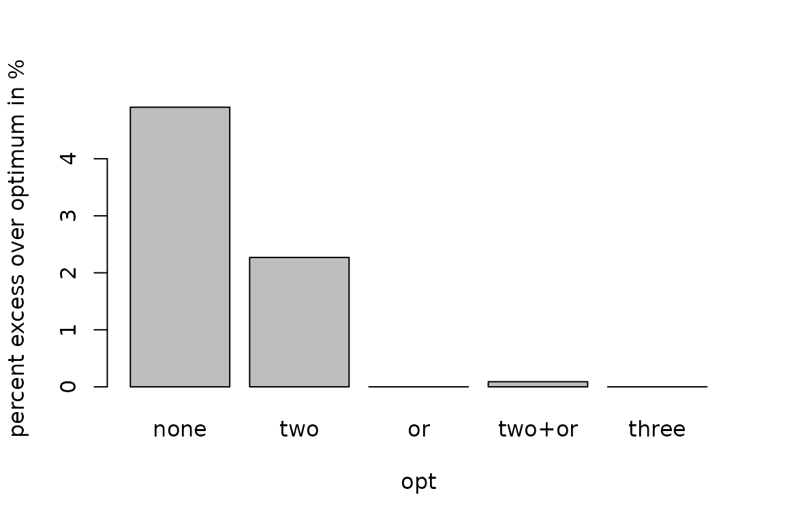

# TSP solution methods

This vignette uses the R package **TSP** (Hahsler and Hornik 2007).
Please cite the package and the accompanying Journal of Statistical
Software paper (see `citation("TSP")`) when you use it in your work.

Finding the shortest tour is NP-hard, so the number of tours that would
have to be checked for an exact solution grows factorially with the
number of cities. For this reason, **TSP** offers fast heuristics that
find good (but not necessarily optimal) tours and an interface to the
exact solver Concorde. This vignette describes the implemented methods
and shows how to choose and compare them. All methods are called through
the same function:

``` r

solve_TSP(x, method, control, ...)
```

where `x` is a `TSP`, `ATSP` or `ETSP` problem, `method` selects the
algorithm, and additional arguments (or the list `control`) set
method-specific parameters. The result is a `TOUR` object. See
[`?solve_TSP`](https://michael.hahsler.net/TSP/reference/solve_TSP.md)
for the complete list of parameters.

## Overview of the methods

| Method argument | Algorithm | Type | Problems | Control parameters |
|:---|:---|:---|:---|:---|
| `"identity"`, `"random"` | Order in the data / random order | construction | TSP, ATSP | `rep`, `opt`, `verbose` |
| `"nn"` | Nearest neighbor | construction | TSP, ATSP | `start`, `rep`, `opt`, `verbose` |
| `"repetitive_nn"` | Nearest neighbor from every start city | construction | TSP, ATSP | `opt`, `verbose` |
| `"nearest_insertion"` | Nearest insertion | construction | TSP, ATSP | `start`, `rep`, `opt`, `verbose` |
| `"farthest_insertion"` | Farthest insertion | construction | TSP, ATSP | `start`, `rep`, `opt`, `verbose` |
| `"cheapest_insertion"` | Cheapest insertion | construction | TSP, ATSP | `start`, `rep`, `opt`, `verbose` |
| `"arbitrary_insertion"` | Arbitrary insertion | construction | TSP, ATSP | `start`, `rep`, `opt`, `verbose` |
| `"two_opt"` | 2-opt exchange | improvement | TSP, ATSP | `tour`, `two_opt_repetitions`, `rep`, `opt`, `verbose` |
| `"or_opt"` | Or-opt segment insertion | improvement | TSP, ATSP | `tour`, `max_segment`, `rep`, `opt`, `verbose` |
| `"three_opt"` | 3-opt exchange | improvement | TSP, ATSP | `tour`, `rep`, `opt`, `verbose` |
| `"sa"` | Simulated annealing | improvement | TSP, ATSP | `tour`, `local_move`, `temp`, `tmax`, `maxit`, `trace`, `rep`, `opt`, `verbose` |
| `"concorde"` | Concorde (exact, branch-and-cut) | external solver | TSP, ETSP | `clo`, `precision`, `keep_files`, `verbose`, `seed` |
| `"linkern"` | Chained Lin-Kernighan | external solver | TSP, ETSP | `clo`, `precision`, `keep_files`, `verbose`, `seed` |

Most heuristics accept the following common control parameters:

- `rep`: the number of random restarts. The best tour found is returned.
- `opt`: refine the constructed tour by local search: `"two"` (2-opt),
  `"or"` (Or-opt), `"three"` (3-opt), or `"two+or"` (2-opt and Or-opt
  alternately). The older `two_opt = TRUE` is deprecated; use
  `opt = "two"`.
- `start`: the first city for nearest neighbor and insertion algorithms.
- `verbose`: show progress and the parameters that are used.

If no method is given,
[`solve_TSP()`](https://michael.hahsler.net/TSP/reference/solve_TSP.md)
uses arbitrary insertion followed by 2-opt improvement. Construction
heuristics build a tour from scratch, while improvement heuristics start
with an existing tour (given as `tour`) and try to shorten it. If no
tour is supplied to an improvement heuristic, a random tour is used.

## Tour construction heuristics

These algorithms create a tour from scratch.

### Nearest neighbor

The nearest neighbor algorithm (Rosenkrantz et al. 1977) is a simple
greedy procedure. It starts with a randomly chosen city (or the city
given by `start`) and repeatedly appends the nearest city that has not
been visited yet. It is very fast, but typically has to make long
“jumps” at the end of the tour to reach the remaining cities.

The repetitive variant (`"repetitive_nn"`) runs the algorithm once from
every city and returns the shortest tour found.

### Insertion algorithms

All insertion algorithms (Rosenkrantz et al. 1977) start with a tour
consisting of a single city and repeatedly insert a city \\k\\ that is
not yet on the tour between two consecutive tour cities \\i\\ and \\j\\
so that the increase in tour length

\\d(i,k) + d(k,j) - d(i,j)\\

is minimal. They differ in how the city to be inserted is chosen:

- **Nearest insertion** chooses the city closest to any city on the
  tour.
- **Farthest insertion** chooses the city farthest from the tour. This
  first establishes an outline of the whole tour and fills in details
  later. In practice, farthest insertion often produces better tours
  than the other insertion variants.
- **Cheapest insertion** chooses the city with the lowest insertion
  cost.
- **Arbitrary insertion** chooses a random city. It is the fastest
  variant.

For distances that obey the triangle inequality, nearest and cheapest
insertion are related to Prim’s minimum spanning tree algorithm (Prim
1957) and guarantee tours that are at most twice the optimal length.

## Tour improvement heuristics

These heuristics modify existing tours to improve them. If no starting
tour is specified then typically a random tour is used as the starting
point.

2-opt is very effective. Many methods have for convenience the control
parameter `opt` which automatically applies a refinement to the
constructed tour. It can be `"two"` (2-opt), `"or"` (Or-opt), `"three"`
(3-opt), or `"two+or"` (2-opt and Or-opt alternately until neither
improves the tour). For example,
`solve_TSP(x, method = "nn", opt = "two+or")`. Without a method,
[`solve_TSP()`](https://michael.hahsler.net/TSP/reference/solve_TSP.md)
uses arbitrary insertion with `opt = "two"`. The older control parameter
`two_opt = TRUE` is deprecated.

### 2-opt

Two-opt (Croes 1958) repeatedly removes two edges from the tour and
reconnects the two resulting paths in the only other possible way (which
is equivalent to reversing a part of the tour) whenever this shortens
the tour. The procedure stops at a *2-optimal* tour, i.e., a local
optimum for this neighborhood. `"two_opt_repetitions"` can be used to
restart the algorithm from random tours.

### Or-opt

Or-opt (Or 1976) moves a segment of 1 to `max_segment` consecutive
cities (default 3) to a different position in the tour, whenever this
shortens the tour. For symmetric problems, the segment may also be
inserted in reverse order. Or-opt can relocate a misplaced city or a
small group of cities in a single step, which 2-opt cannot do, while
2-opt removes crossing edges, which Or-opt cannot do. The two methods
complement each other, which is why `opt = "two+or"` alternates between
them. Or-opt only needs a few moves to be checked and is about as fast
as 2-opt.

### 3-opt

Three-opt (Bock 1958; Lin 1965) removes three edges, which splits the
tour into three parts, and reconnects them in the best of all possible
ways (including reversing parts). Its neighborhood contains all 2-opt
and Or-opt moves, so a *3-optimal* tour is also 2-optimal and
Or-optimal. The price is a run time of \\O(n^3)\\ for each pass over all
triples of edges, which makes 3-opt practical only for small to medium
problems (up to a few thousand cities). For asymmetric problems, only
the reconnection that does not reverse any part of the tour is used.

### Simulated annealing

Simulated annealing (Kirkpatrick et al. 1983) uses random local moves
(reversal of a random sub-tour) and accepts moves that make the tour
longer with a probability that decreases as the temperature is lowered.
This allows the search to escape local optima. The implementation uses
[`stats::optim()`](https://rdrr.io/r/stats/optim.html) with method
`"SANN"`. The method is usually much slower than 2-opt and needs tuning
of the cooling schedule (`temp`, `tmax`, `maxit`). By default, only
10,000 evaluations are used to keep the run time short, so a larger
`maxit` is needed for competitive results.

### Improving an existing tour

Improvement heuristics can be applied to any tour, including a tour that
was created outside of **TSP**. For example, we can refine a nearest
neighbor tour with 2-opt, Or-opt, and 3-opt, and then use a long
simulated annealing run for further improvement.

``` r

library(TSP)
data(USCA50)
set.seed(1234)

nn <- solve_TSP(USCA50, method = "nn", start = 1)
opt2 <- solve_TSP(USCA50, method = "two_opt", tour = nn)
optor <- solve_TSP(USCA50, method = "or_opt", tour = opt2)
opt3 <- solve_TSP(USCA50, method = "three_opt", tour = optor)
sa <- solve_TSP(USCA50, method = "sa", tour = opt3, maxit = 50000)

c(nn = tour_length(nn), two_opt = tour_length(opt2),
  or_opt = tour_length(optor), three_opt = tour_length(opt3),
  sa = tour_length(sa))
#>        nn   two_opt    or_opt three_opt        sa 
#>     17203     16324     15499     14497     14497
```

We see how improvement methods reduce the tour length. The same
refinements can be requested directly when a tour is constructed using
`opt`. We set the same random number seed inside the loop to get the
same nearest-neighbor tour. We run each algorithm with 10 random
restarts.

``` r


opts <- c("none", "two", "or", "two+or", "three")
## nearest neighbor breaks ties randomly. We reset the seed so every
## refinement starts from the same nearest neighbor tour.
len <- sapply(opts, function(o) {
  set.seed(1234)
  tour <- solve_TSP(USCA50, method = "nn", rep = 10,
    opt = if (o == "none") NULL else o)
  tour_length(tour)
})
#> Warning: executing %dopar% sequentially: no parallel backend registered
len
#>   none    two     or two+or  three 
#>  15208  14826  14497  14510  14497

## the optimal tour length (found by Concorde) is 14497
barplot(len / 14497 * 100 - 100, xlab = "opt",
  ylab = "percent excess over optimum in %")
```



## State-of-the-art solvers

Concorde (Applegate et al. 2006) is currently one of the best exact
solvers for symmetric TSPs. It uses the branch-and-cut method (Padberg
and Rinaldi 1990) which iteratively tightens a linear programming
relaxation of the problem. The Chained Lin-Kernighan heuristic
(Applegate et al. 2003), an extension of the Lin-Kernighan heuristic
(Lin and Kernighan 1973), is a very fast heuristic that finds excellent
tours for large instances. Both are accessed via the `"concorde"` and
`"linkern"` methods, but require that the Concorde executables are
installed separately. See
[`vignette("concorde")`](https://michael.hahsler.net/TSP/articles/concorde.md)
for details.

## Asymmetric and Euclidean problems

All heuristics above work with asymmetric problems (`ATSP`). Solvers
that only handle symmetric problems use an automatic reformulation as a
symmetric TSP with twice as many cities (see
[`?reformulate_ATSP_as_TSP`](https://michael.hahsler.net/TSP/reference/reformulate_ATSP_as_TSP.md)).

Euclidean problems (`ETSP`) are converted into distance matrices for the
built-in heuristics, which needs memory proportional to the square of
the number of cities. Only `"concorde"` and `"linkern"` work with `ETSP`
objects directly.

## Reproducibility

Many methods are randomized (e.g., `"random"`, `"nn"` with a random
start, `"arbitrary_insertion"`, `"sa"`, and all methods with `rep > 1`).
They use R’s global random-number stream. Calling
[`set.seed()`](https://rdrr.io/r/base/Random.html) before
[`solve_TSP()`](https://michael.hahsler.net/TSP/reference/solve_TSP.md)
makes a run reproducible, and every call advances the stream as any
other R function that draws random numbers does.

## Parallel execution

Repetitions (including `"repetitive_nn"`) are run using the **foreach**
package and can be executed in parallel by registering a backend before
calling
[`solve_TSP()`](https://michael.hahsler.net/TSP/reference/solve_TSP.md).

``` r

library(doParallel)
#> Loading required package: foreach
#> Loading required package: iterators
#> Loading required package: parallel
registerDoParallel()
solve_TSP(USCA50, rep = 100)
#> object of class 'TOUR' 
#> result of method 'arbitrary_insertion+two_opt_rep_100' for 50 cities
#> tour length: 14497
```

For parallel repetitions, one random number per repetition is drawn from
R’s global stream in the main R process and used to seed the iteration
(on the main process or a worker). The results are therefore
reproducible with [`set.seed()`](https://rdrr.io/r/base/Random.html)
independent of the backend and the number of workers.

## References

Applegate, David, Robert Bixby, Vasek Chvátal, and William Cook. 2006.
*Concorde TSP Solver*.
<https://www.math.uwaterloo.ca/tsp/concorde.html>.

Applegate, David, William Cook, and Andre Rohe. 2003. “Chained
Lin-Kernighan for Large Traveling Salesman Problems.” *INFORMS Journal
on Computing* 15 (1): 82–92.
<https://doi.org/10.1287/ijoc.15.1.82.15157>.

Bock, F. 1958. “An Algorithm for Solving "Traveling-Salesman" and
Related Network Optimization Problems.” Unpublished manuscript.

Croes, G. A. 1958. “A Method for Solving Traveling-Salesman Problems.”
*Operations Research* 6 (6): 791–812.
<https://doi.org/10.1287/opre.6.6.791>.

Hahsler, Michael, and Kurt Hornik. 2007. “TSP – Infrastructure for the
Traveling Salesperson Problem.” *Journal of Statistical Software* 23
(2): 1–21. <https://doi.org/10.18637/jss.v023.i02>.

Kirkpatrick, S., C. D. Gelatt, and M. P. Vecchi. 1983. “Optimization by
Simulated Annealing.” *Science* 220 (4598): 671–80.
<https://doi.org/10.1126/science.220.4598.671>.

Lin, S. 1965. “Computer Solutions of the Traveling-Salesman Problem.”
*Bell System Technology Journal* 44: 2245–69.

Lin, S., and B. W. Kernighan. 1973. “An Effective Heuristic Algorithm
for the Traveling-Salesman Problem.” *Operations Research* 21 (2):
498–516. <https://doi.org/10.1287/opre.21.2.498>.

Or, I. 1976. “Traveling Salesman-Type Combinatorial Problems and Their
Relation to the Logistics of Regional Blood Banking.” PhD thesis,
Northwestern University.

Padberg, M., and G. Rinaldi. 1990. “Facet Identification for the
Symmetric Traveling Salesman Polytope.” *Mathematical Programming*
(Secaucus, NJ, USA) 47 (2): 219–57.

Prim, R. C. 1957. “Shortest Connection Networks and Some
Generalisations.” *Bell System Technical Journal* 36: 1389–401.

Rosenkrantz, Daniel J., Richard E. Stearns, and Philip M. Lewis II.
1977. “An Analysis of Several Heuristics for the Traveling Salesman
Problem.” *SIAM Journal on Computing* 6 (3): 563–81.
<https://doi.org/10.1007/978-1-4020-9688-4_3>.
